<div align="center">

# LUNAE

**Bilingual (BM/EN) storefront for a Malaysian halal makeup & skincare brand designed for tropical heat.**
Customers find their exact shade with an on-device AI shade finder, try lip colours live in AR, build a routine for today's weather and check out with server-verified prices.
The whole site switches from a Day to a Moonlight edition at local sunset.
**Pre-launch preview: checkout runs in demo mode.**

**[Live demo → lunae-rho.vercel.app](https://lunae-rho.vercel.app)** · Bahasa Melayu at [/ms](https://lunae-rho.vercel.app/ms) · admin preview at [/en/admin](https://lunae-rho.vercel.app/en/admin) (sample data)

       

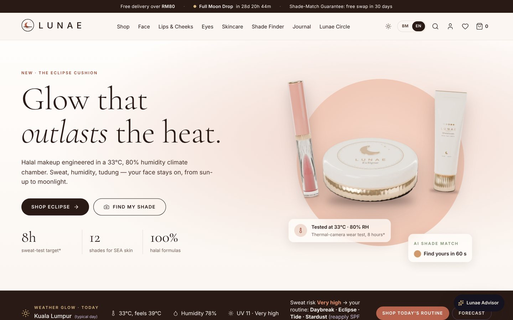

</div>

---

## Why this exists

LUNAE started as a 119-page brand and business proposal. Part D of that proposal specifies the e-commerce system; this repository is the storefront built from it.

| Problem | What the LUNAE storefront does |
|---|---|
| Makeup slides off in 33°C, 80% humidity | Products, concern pages and routines are built around sweat-test targets; **Weather Glow** turns live heat, humidity and UV into a "sweat risk" score and a routine |
| Buying a base shade online is a gamble | **AI Shade Finder**: guided selfie analysed on the device, matched with CIELAB / ΔE2000 colour science, plus a skin-tone preview and a 30-day Shade-Match Guarantee |
| Swatching lipstick is impossible online | **Live AR try-on** for lips and cheeks in the browser, with four shades side by side, no app download |
| Halal claims are hard to verify | **Ingredient Explorer** with the halal status of every INCI ingredient, and a **batch trace** page per QR code |
| Generic chatbots make things up | **Lunae Advisor** answers only from the catalogue and policies, in BM, English and Manglish, and hands off to a human |
| Prices can be tampered with in the browser | The server recomputes every price; an order is marked paid only after an **HMAC-signed payment webhook** |

## Features

**Storefront**: Day and Midnight editions of the home page · shop and 4 categories with URL-synced filters and "best match for me" sort · 6 concern pages with FAQ schema · instant search with typo tolerance and BM/EN synonyms · 16 product pages with gallery, zoom and 360° preview, shade selector, skin-tone preview, Ingredient Explorer, Sweat-Test slider, Q&A and "complete the routine" · sets and gift mode · journal · ingredient glossary · Sweat-Test Lab · halal promise · stockists · help centre · policies · branded 404, waiting room and maintenance pages.

**Signature features**: Sun-up → Moonlight theme from the local sunset (SunCalc) · Weather Glow (Open-Meteo) · AI Shade Finder (guided selfie or 6-question quiz) · live AR lip and cheek try-on (MediaPipe Face Landmarker + WebGL) · Routine Builder with drag and drop and live bundle pricing · Lunae Advisor · Full Moon Drops with moon-phase countdown, waitlist and fair virtual queue · batch and halal trace · Refill Radar.

**Buy**: cart drawer and page with free-shipping meter, save for later and vouchers · one-page checkout with express methods, Malaysian phone and postcode → state validation, East Malaysia rates, gift mode, Lunae Circle points and a 15-minute reservation timer · demo payment step and signed webhook · order confirmation and tracking.

**Account**: order timeline and rider map · 3-tap shade swap · refills · skin and shade profile · Lunae Circle points ledger and rewards · wishlist · addresses · passkeys and security · PDPA privacy centre (consents, data download, delete).

**Partners & admin preview**: partner portal and KYC application · admin command centre with KPIs, revenue chart, channel mix and FEFO watch, plus module views. Sample data only.

<table>
<tr>
<td>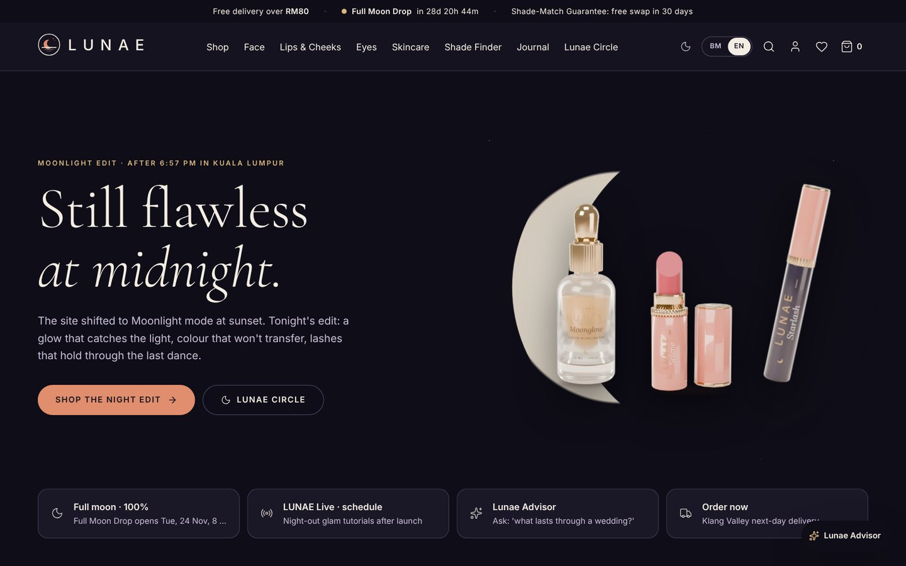</td>
<td>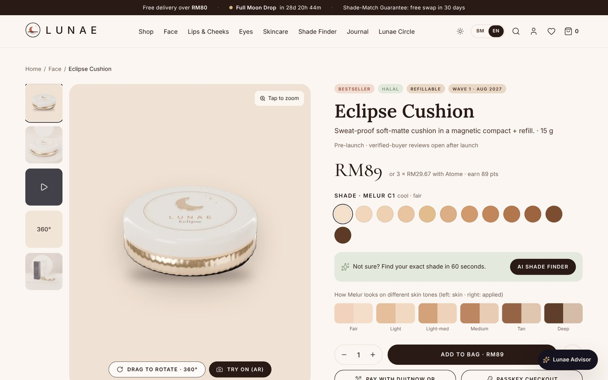</td>
</tr>
<tr>
<td>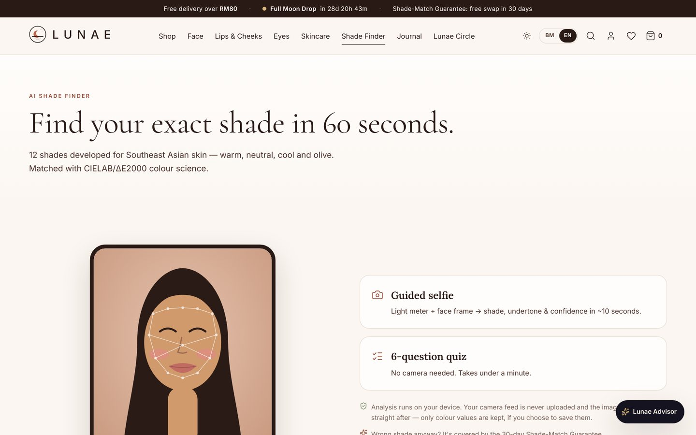</td>
<td>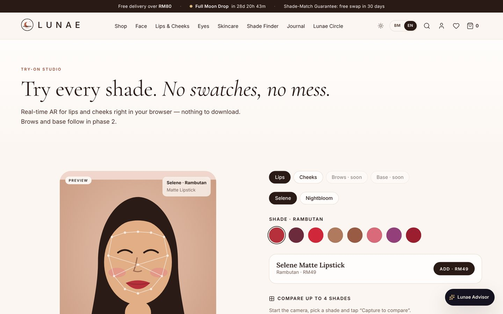</td>
</tr>
<tr>
<td>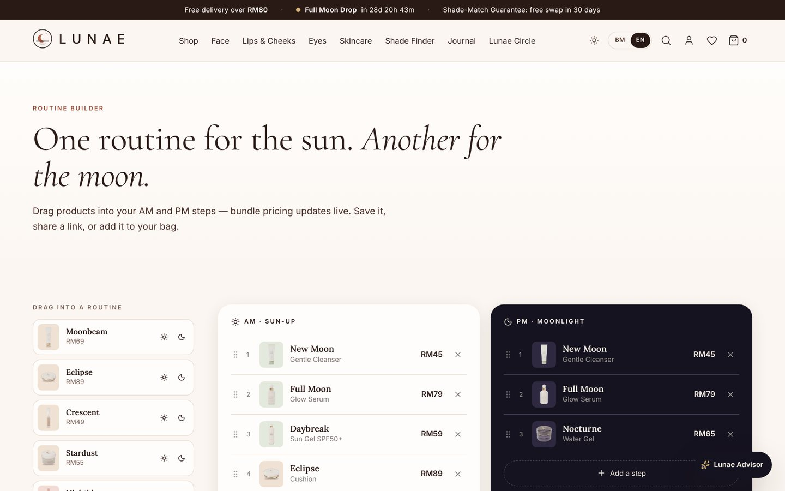</td>
<td>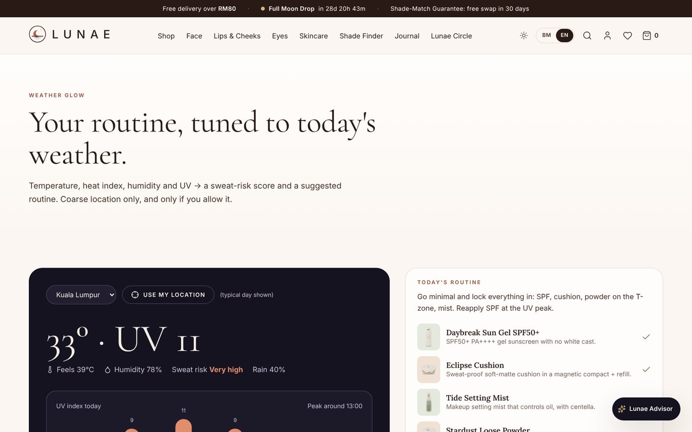</td>
</tr>
<tr>
<td>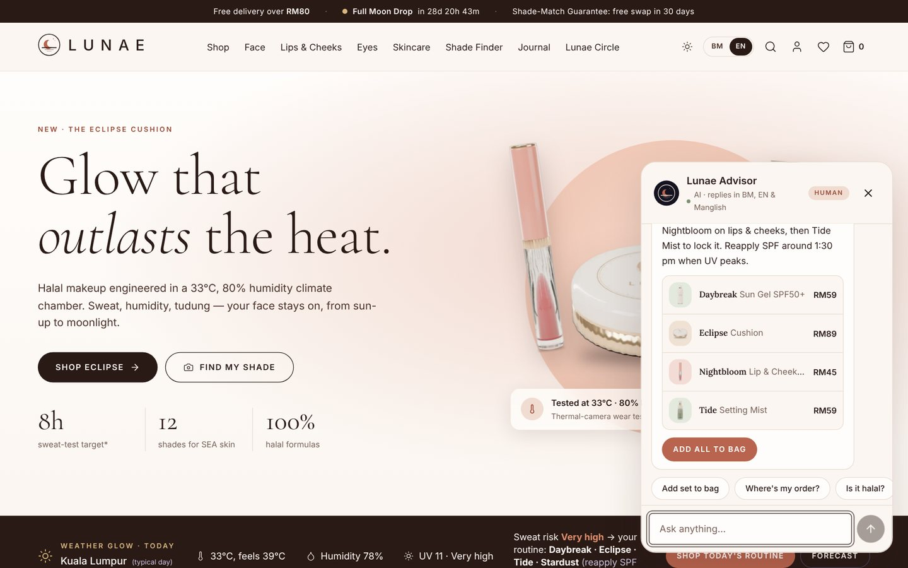</td>
<td>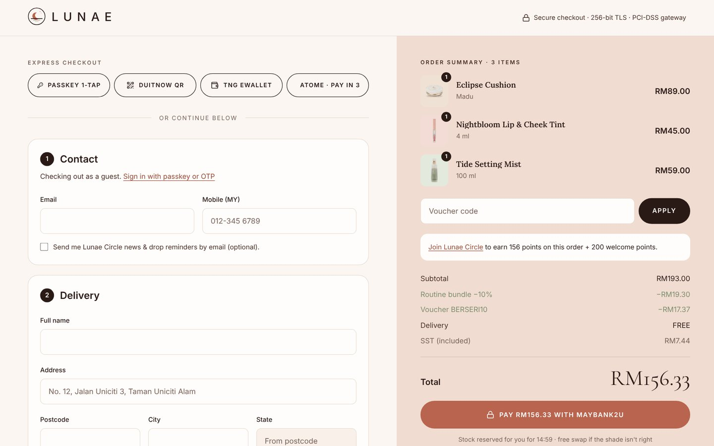</td>
</tr>
<tr>
<td>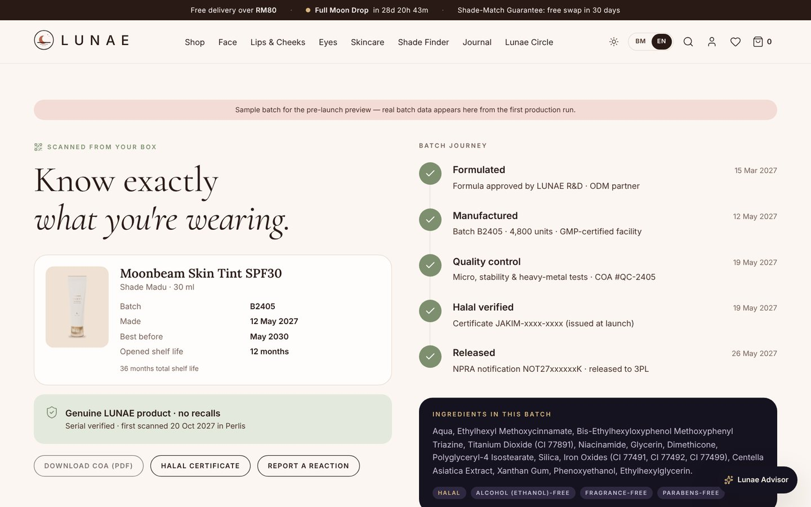</td>
<td>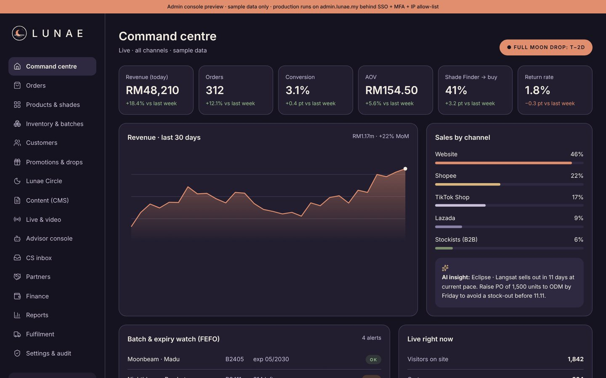</td>
</tr>
</table>

<p align="center">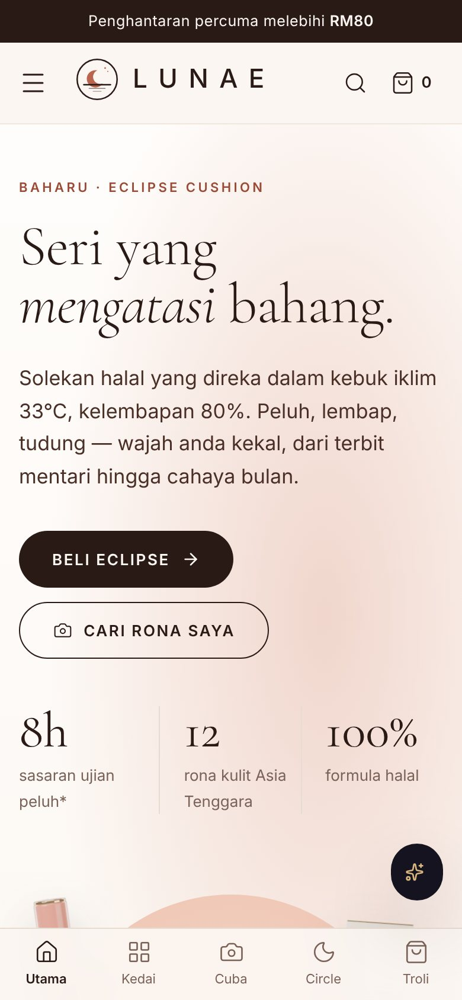</p>

## How checkout works

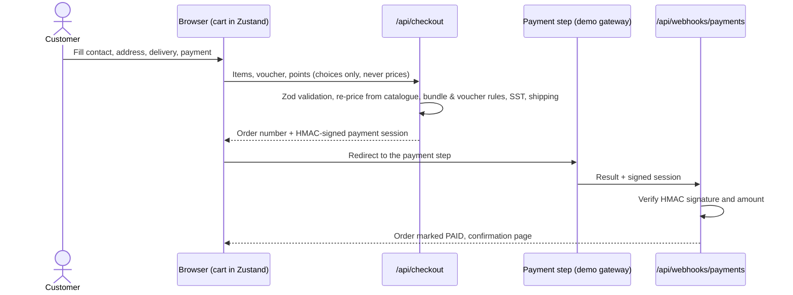

A tampered session or amount is rejected with `401`. The Malaysian phone and postcode → state helpers used in the browser are the same ones the server runs inside its Zod schema.

## Architecture

```
lunae/
├── src/app/[lang]/(store)/     Storefront and account pages (/en and /ms)
├── src/app/[lang]/(checkout)/  Checkout and payment step
├── src/app/[lang]/partners/    Partner portal and application
├── src/app/[lang]/admin/       Admin command centre (sample data, noindex)
├── src/app/api/                advisor · checkout · webhooks/payments · contact · waitlist · trace · partners
├── src/proxy.ts                Locale redirect from cookie / Accept-Language
├── src/components/             UI: chrome, product page, shade finder, try-on, routine builder, checkout, account
├── src/lib/                    i18n · pricing · colour science (CIELAB, ΔE2000) · shade matching · astronomy
│                               weather · search · advisor · checkout schemas · HMAC signing · stores
├── src/data/                   Catalogue (16 products), ingredient lists, journal, policies, sample batches
├── public/                     Product renders, icons, PWA service worker
└── docs/screenshots/           Images used in this README
```

- **Server is the source of truth for money**: the browser only sends choices; prices, discounts, SST and shipping are recomputed in `/api/checkout`.
- **Privacy by design**: face analysis for the Shade Finder and AR runs on the device; camera frames are never uploaded.
- **Cache Components / Partial Prerendering**: about 160 routes are prerendered, with dynamic parts streamed inside `<Suspense>`.
- **Bilingual from the route up**: `/[lang]` root layout with `en` and `ms`, `hreflang`, and every string stored in both languages.

## Tech stack

Next.js 16 (App Router, Cache Components, `proxy.ts`) · React 19 · TypeScript (strict) · Tailwind CSS 4 with design tokens for the Day and Midnight palettes · Zustand · Zod · MediaPipe Face Landmarker · SunCalc · Open-Meteo · Fontsource (Cormorant Garamond, Lora, Inter) · PWA service worker · JSON-LD · Vercel.

## Run it locally

```bash
npm install
npm run dev          # http://localhost:3000
npm run build && npm start
```

### Configuration

Copy `.env.example` to `.env.local`. Everything is optional for local development.

| Variable | Purpose |
|---|---|
| `NEXT_PUBLIC_SITE_URL` | Canonical URL for the sitemap, Open Graph and JSON-LD (Vercel's production URL is used automatically) |
| `PAYMENT_WEBHOOK_SECRET` | HMAC secret for signed payment sessions and webhooks. **Required in production** |
| `ANTHROPIC_API_KEY`, `ADVISOR_MODEL` | Lunae Advisor answers with Claude; without a key it uses the built-in rule engine |
| `CONTACT_WEBHOOK_URL`, `WAITLIST_WEBHOOK_URL`, `PARTNER_WEBHOOK_URL`, `ADVERSE_EVENT_WEBHOOK_URL` | Forward forms to a helpdesk or CRM |

## Scripts

| Command | What it does |
|---|---|
| `npm run dev` | Run the app in development |
| `npm run build` | Production build |
| `npm start` | Serve the production build |
| `npm run lint` | ESLint |
| `npm run typecheck` | TypeScript type check |

## Project status

This is a **pre-launch preview**. Built and working: every storefront, checkout and account page, the signature features above, server-side pricing and the signed payment webhook. In demo form: payment (no gateway connected, no money is taken), accounts and orders (stored on the device), the partner portal and admin console (sample data). Claims marked `*` on the site are targets pending independent testing, and reviews open to verified buyers after launch.

## Roadmap

- [x] Storefront, product pages, search, concern pages, journal, policies (BM/EN)
- [x] AI Shade Finder, AR lip and cheek try-on, Routine Builder, Weather Glow, Lunae Advisor
- [x] Checkout with server-side pricing and HMAC-signed webhook (demo gateway)
- [ ] Licensed Malaysian payment gateway (FPX, cards 3-D Secure, DuitNow QR, e-wallets, BNPL)
- [ ] Commerce engine and database for accounts, orders and the points ledger
- [ ] Courier rates and tracking, marketplace and stock sync
- [ ] AR for brows and base, 3D product viewer
- [ ] Publish NPRA notification numbers, JAKIM halal certificates and lab reports

## About

Built by **Mohamad Amirul Asyraf** from his own LUNAE brand and business proposal, with AI-assisted development (Claude). Product images are 3D renders made for the brand.

© 2026 Mohamad Amirul Asyraf. All rights reserved. Source shared for portfolio viewing only; not licensed for reuse. See [LICENSE](LICENSE). The LUNAE name, brand assets and business material are also proprietary.
